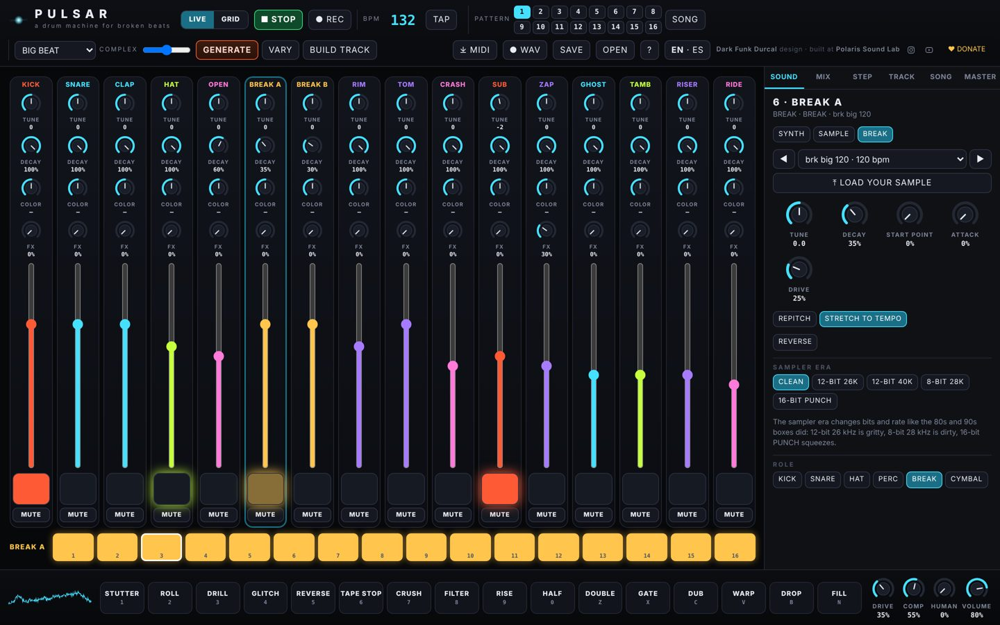

<h1 align="center">P U L S A R</h1>
<p align="center"><b>a drum machine for broken beats</b> · <i>una caja de ritmos para beats rotos</i><br>
Dark Funk Durcal design · built at <b>Polaris Sound Lab</b>, Mérida, Yucatán, México<br>
<a href="https://www.instagram.com/polaris.sound.lab/">Instagram @polaris.sound.lab</a> · <a href="https://www.youtube.com/@PolarisSoundLab">YouTube @PolarisSoundLab</a></p>

<p align="center">
<a href="https://drophlex.github.io/PULSAR/"><b>▶ Play it in your browser</b></a> &nbsp;·&nbsp;
<a href="#-ableton-live--mac-vst3--au"><b>🎛 Ableton / Mac plug-in</b></a> &nbsp;·&nbsp;
<a href="manual/PULSAR-Manual-EN.pdf"><b>📘 Manual (English)</b></a> &nbsp;·&nbsp;
<a href="manual/PULSAR-Manual-ES.pdf"><b>Manual (Español)</b></a> &nbsp;·&nbsp;
<a href="https://www.paypal.com/donate/?business=drophlex%40gmail.com&no_recurring=0&item_name=PULSAR&currency_code=USD"><b>♥ Donate</b></a>
</p>

<p align="center"></p>

**English** · [Español](#español)

PULSAR is a drum machine for big beat, braindance, drill'n'bass, jungle and every broken rhythm in between — as easy to play live as a hardware box, with far more sound and depth. Free and open source. The program is in English; the **EN · ES** button switches it to Spanish.


## Manuals

Illustrated, in English and Spanish, one for each edition:

| Edition | English | Español | Both |
|---|---|---|---|
| 🎛 **Plug-in** (VST3 · AU · App, Ableton Live) | [EN](manual/PULSAR-VST-Manual-EN.pdf) | [ES](manual/PULSAR-VST-Manual-ES.pdf) | [EN + ES](manual/PULSAR-VST-Manual-EN-ES.pdf) |
| 🌐 **Web** | [EN](manual/PULSAR-Web-Manual-EN.pdf) | [ES](manual/PULSAR-Web-Manual-ES.pdf) | [EN + ES](manual/PULSAR-Web-Manual-EN-ES.pdf) |
| 🎹 **M-VAVE FM-1** (as a controller; the native firmware is in development) | [EN](manual/PULSAR-FM1-Manual-EN.pdf) | [ES](manual/PULSAR-FM1-Manual-ES.pdf) | [EN + ES](manual/PULSAR-FM1-Manual-EN-ES.pdf) |

The complete manual (every edition together): [EN](manual/PULSAR-Manual-EN.pdf) · [ES](manual/PULSAR-Manual-ES.pdf) · [EN + ES](manual/PULSAR-Manual-EN-ES.pdf)

## ⚡ Quick start

1. Open **[drophlex.github.io/PULSAR](https://drophlex.github.io/PULSAR/)** in Chrome and press **START**.
2. Pick a **style** (BIG BEAT, BRAINDANCE, DRILL N BASS, JUNGLE…) and press **⚡ GENERATE**.
3. **Play it**: faders, pads, MUTE, and the 16 one-button tricks at the bottom (tap = latch, hold = momentary).
4. **● REC** writes your tricks, knob moves and pad hits into the pattern.
5. **BUILD TRACK** makes a whole song; **⤓ MIDI** or **● WAV** takes it to your DAW.

## 🎛 Ableton Live · Mac (VST3 · AU)

Open **Terminal** and paste:

```
curl -fsSL https://drophlex.github.io/PULSAR/install.sh | bash
```

Then go to Ableton → *Settings → Plug-ins → Use VST3 Plug-in System Folders → Rescan*, and find it under *Plug-ins → Polaris Sound Lab → PULSAR*. If you'd rather not use Terminal, download [PULSAR-mac.zip](https://github.com/drophlex/PULSAR/releases/latest/download/PULSAR-mac.zip) (Apple Silicon and Intel, macOS 11+) and open *Install PULSAR.command*.

- It plays with Live's transport, tempo and bar, including loops and jumps.
- MIDI notes C1–D#2 play the 16 pads.
- It has **238 automatable parameters**, including the 16 tricks as on/off switches you can record in the arrangement.
- Everything is saved inside the Live set.

## What's inside

- **16 tracks**, each a synth (14 drum models), a sample or a **break** sliced into 32 steps.
- **Breaks you can chop and time-stretch** (or repitch, jungle style). Load your own loop: it is measured and sliced automatically.
- **Sampler eras** per track: 12-bit 26 kHz, 12-bit 40 kHz, 8-bit 28 kHz, 16-bit punch.
- **A sequencer that goes beyond the DAW**: per-track length and speed (polymeter, triplets), direction, velocity, chance, micro timing, pitch, slice, rolls ×2–×8 with shapes and their own chance, conditions (1:2…4:4, FILL, FIRST), Euclid.
- **16 performance tricks**: STUTTER, ROLL, DRILL, GLITCH, REVERSE, TAPE STOP, CRUSH, FILTER, RISE, HALF, DOUBLE, GATE, DUB, WARP, DROP, FILL — all recordable, plus knob motion recording.
- **Mixer**: level, pan, reverb and delay sends, filter, drive, sidechain duck, choke groups; master drive, glue compressor, swing, humanize.
- **13 style generators**, VARY, and BUILD TRACK (8 patterns + a 13-part song).
- **MIDI export** (pattern or song), **WAV recording**, project files, MIDI input (notes 36–51).
- **LIVE view** (a strip per instrument and a step row, like hardware) and **GRID view** (all 16 tracks).

### New in PULSAR 2

- **Multi-out** in the plug-in: 8 extra stereo outputs. MIX › OUTPUT sends any track to its own channel in Ableton (*Audio From → PULSAR → Bus 1…8*).
- **Drag MIDI out**: drag **⇱ MIDI** onto a MIDI track, and the pattern or the song becomes a clip that plays PULSAR. TRACK › DRAG MIDI drags one track.
- **Note repeat** (1/8 · 1/16 · 1/32 · 1/16T): hold a pad and it repeats in time, like an MPC. Pad velocity can be turned on or off.
- **XY performance pad**: left sweeps a low-pass, right a high-pass, and up throws everything into reverb and delay. It springs back when you let go, or HOLD keeps it.
- **PUNCH · GLUE · LOW · HIGH** on every track: a transient shaper, a compressor and two ±12 dB shelves.
- **Lock · Dice · Mutate** per track: keep a part through GENERATE, VARY, BUILD and kits, write a new part for one track, or nudge it.
- **Resample** one loop into a track. **Drop your own samples** on any row or strip.
- **MIDI learn**: right-click a knob, a trick or the XY pad, then move a control on your keyboard. It is saved with the set, and the web version has it too.
- **Undo / redo** (⌘Z / ⇧⌘Z), **MIDI out** of the sequence (notes 36–51, channel 10), and 238 automatable parameters.

## Sounds

133 sounds, every one free to share — from the best free drum libraries: **SM Drums** (public domain), **Big Rusty Drums**, **Frankensnare**, **Unruly Drums** and **Gogodze Phu Vol II** by Karoryfer Samples (CC0), classic rhythm machines (public domain), and breaks and designed sounds made in PULSAR (CC0). Details: [sounds/CREDITS.md](sounds/CREDITS.md).

## Coming next

- **M-VAVE FM-1 firmware**, in development.

## Build

`python3 tools/build_kits.py` (sound library) · `python3 tools/pack_sounds.py` · `python3 tools/build_web.py` → `index.html` (needs clang + wasm-ld). The engine (`engine/pulsar.h`) is header-only C++ with no libc: the same code for the web, the plug-in and the FM-1. Manual: `tools/manual/`.

## Licence

PULSAR is free software under the **GNU AGPL-3.0** ([LICENSE](LICENSE)). The sounds keep their own free licences ([sounds/CREDITS.md](sounds/CREDITS.md)). Names of machines and artists belong to their owners; PULSAR is not affiliated with them.

If PULSAR makes your music better: **[♥ donate with PayPal](https://www.paypal.com/donate/?business=drophlex%40gmail.com&no_recurring=0&item_name=PULSAR&currency_code=USD)**.

---

## Español

PULSAR es una caja de ritmos para big beat, braindance, drill'n'bass, jungle y todo ritmo roto que haya entre ellos — tan fácil de tocar en vivo como una caja de hardware, con mucho más sonido y profundidad. Gratis y de código abierto. El programa está en inglés; el botón **EN · ES** lo cambia a español.

**Inicio rápido:** abre **[drophlex.github.io/PULSAR](https://drophlex.github.io/PULSAR/)** en Chrome → **EMPEZAR** → elige un **estilo** → **⚡ GENERAR** → tócalo con los faders, los pads y los 16 trucos (toque = fijo, mantener = momentáneo) → **● REC** graba tus movimientos → **ARMAR TEMA** hace una canción → **⤓ MIDI** o **● WAV** a tu DAW.

**Ableton Live en Mac (VST3 · AU):** en Terminal pega `curl -fsSL https://drophlex.github.io/PULSAR/install.sh | bash`. Luego en Ableton ve a *Ajustes → Plug-ins → Usar carpetas de sistema VST3 → Volver a escanear*. PULSAR sigue el play, el tempo y el compás de Live. Las notas C1–D#2 tocan los pads. Tiene 238 parámetros automatizables, entre ellos los 16 trucos, y todo se guarda en el set. **Nuevo en PULSAR 2:**

- **Multi-salida**: 8 salidas estéreo extra, y cada pista puede ir a su propio canal de Ableton.
- **Arrastrar el patrón como MIDI** a una pista de Ableton.
- **Repetir nota** (1/8, 1/16, 1/32, 1/16T), al estilo MPC.
- **Pad XY**: filtro hacia los lados y espacio hacia arriba.
- **GOLPE+, COMPRESIÓN, GRAVES y AGUDOS** en cada pista.
- **Candado, dado y mutar** por pista.
- **Resamplear** y **soltar tus samples** en cualquier pista.
- **Aprender MIDI** con clic derecho.
- **Deshacer y rehacer**, y **salida MIDI** del secuenciador. **FM-1:** en desarrollo.

📘 **Manuales en español:** [plug-in](manual/PULSAR-VST-Manual-ES.pdf) · [web](manual/PULSAR-Web-Manual-ES.pdf) · [FM-1](manual/PULSAR-FM1-Manual-ES.pdf) · [completo](manual/PULSAR-Manual-ES.pdf)

Dark Funk Durcal design · construido en **Polaris Sound Lab**, Mérida, Yucatán, México. Si PULSAR mejora tu música: **[♥ dona con PayPal](https://www.paypal.com/donate/?business=drophlex%40gmail.com&no_recurring=0&item_name=PULSAR&currency_code=USD)**.
